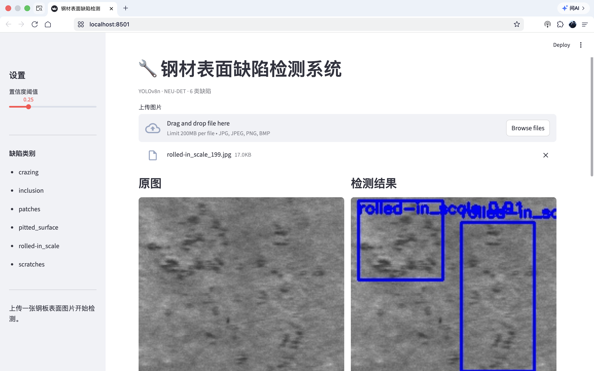
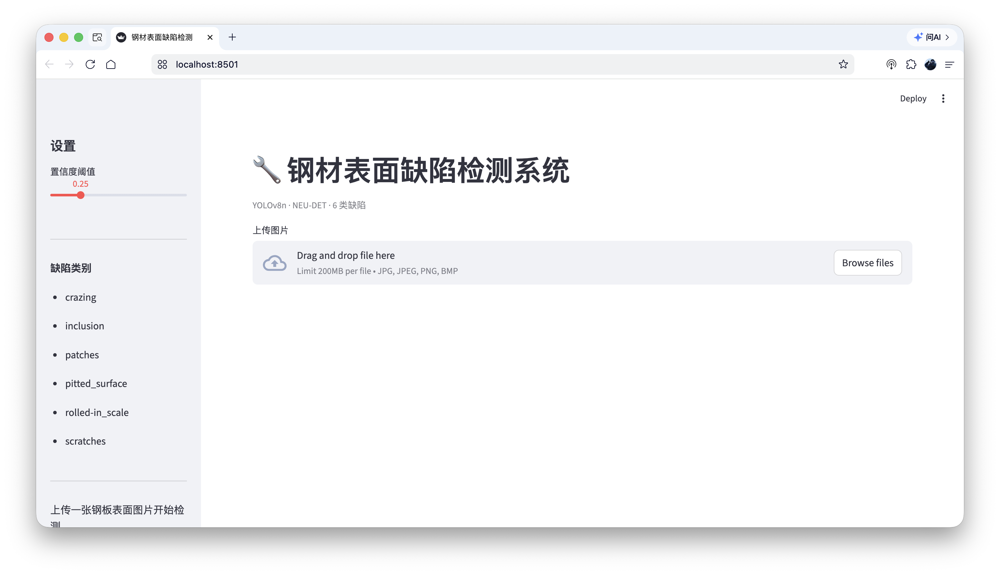
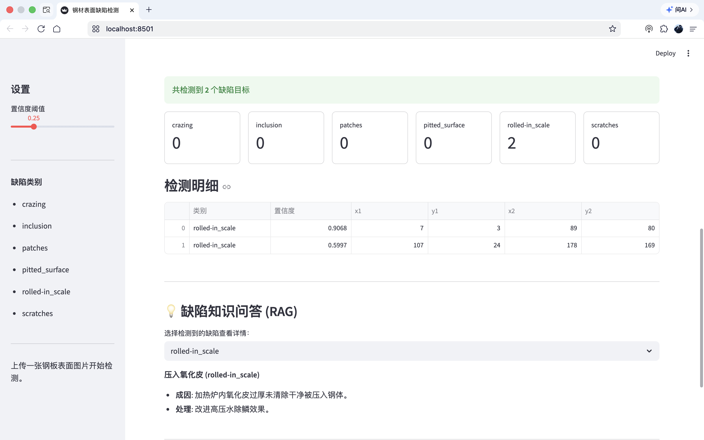

# 钢材表面缺陷智能检测系统

> YOLOv8n + Streamlit 的钢板表面缺陷检测 Demo：上传一张钢板图像，框出 6 类缺陷，给出类别、置信度、数量统计与处理建议。



## 功能

- **YOLOv8n 目标检测**：识别 NEU-DET 的 6 类表面缺陷，单图推理（M1 Mac）小于 0.1s
- **结果可视化**：原图与检测结果并排，框上标注类别与置信度
- **数据统计**：各类缺陷计数卡片 + 检测明细表（类别、置信度、框坐标）
- **规则知识库问答**：按缺陷类型返回预设的成因与处理建议。**实现方式是按关键词匹配固定条目，没有向量检索，也没有接入大语言模型**（早期版本写作「RAG」，表述不准确，已改正）
- **Docker 部署**：镜像内启动 Streamlit

## 缺陷类别与指标

| 类别 | 中文名 | mAP50 |
|------|--------|-------|
| crazing | 裂纹 | 0.441 |
| inclusion | 夹杂物 | 0.834 |
| patches | 斑块 | 0.922 |
| pitted_surface | 点蚀 | 0.773 |
| rolled-in_scale | 压入氧化皮 | 0.619 |
| scratches | 划痕 | 0.935 |

总体 mAP50 = 0.754。

以上数字取自训练结束时的验证集评估输出。该次训练的 `runs/` 目录（`results.csv`、`results.png`、`confusion_matrix.png` 等）**没有随本仓库提交**，所以仓库内没有可直接查看的原始产物。要核对数字，请按下文「评估」一节在相同的数据划分下重跑 `eval.py`；结果会因数据划分、随机种子和环境差异略有出入。

## 界面预览

### 初始界面

左侧为设置栏（置信度阈值滑块 + 6 类缺陷列表），右侧为图片上传区。



### 检测效果

上传钢板图片后，模型自动框出缺陷并标注类别与置信度，同时给出原图与结果图的并排对比。


### 数据统计与知识问答

底部展示缺陷计数、检测明细表，以及按类别返回的成因与处理建议。



## 快速开始

### 1. 克隆仓库

```bash
git clone https://github.com/1141413675/steel-defect-detector.git
cd steel-defect-detector
```

### 2. 创建虚拟环境

```bash
python3 -m venv venv
source venv/bin/activate
```

### 3. 安装依赖

```bash
pip install -r requirements.txt
```

依赖清单见 `requirements.txt`，其中没有锁定版本号（训练与演示时所用的具体版本未记录），安装时由 pip 解析当前可用的版本。如果遇到版本冲突，建议优先固定 `ultralytics` 与 `streamlit` 两个包。

### 4. 准备权重

本仓库不包含模型权重（`weights/` 在 `.gitignore` 中）。需要通过下面的「模型训练」自行训练，或向作者索取 `best.pt`，放到：

```
weights/best.pt
```

也可以用环境变量指定其他位置：

```bash
export MODEL_PATH=/path/to/best.pt
```

权重缺失时页面仍能正常打开，侧栏会提示「没有找到权重文件」，此时上传图片不会崩溃，只会提示无法检测。

### 5. 启动

```bash
streamlit run app.py
```

浏览器打开 `http://localhost:8501`。

## Docker 部署

```bash
docker build -t steel-defect-detector .
docker run -p 8501:8501 steel-defect-detector
```

镜像内不包含权重，运行时请把权重目录挂载进去：

```bash
docker run -p 8501:8501 -v "$PWD/weights:/app/weights" steel-defect-detector
```

## 模型训练

```python
from ultralytics import YOLO

model = YOLO("yolov8n.pt")
model.train(
    data="data.yaml",
    epochs=100,
    imgsz=640,
    batch=16,
    name="steel_yolov8n",
)
```

训练完成后，把 `runs/detect/steel_yolov8n/weights/best.pt` 放到 `weights/` 目录。

仓库里没有训练脚本的封装，上面这段就是训练时使用的入口，数据集路径由 `data.yaml` 指定。

## 评估

```bash
python eval.py --weights weights/best.pt --data data.yaml
```

脚本会调用 Ultralytics 的 `val()`，打印总体 mAP50、mAP50-95 和每个类别的 mAP50，与上表的统计口径一致。

验证集的划分在 `data.yaml` 中通过 `images/train` 与 `images/val` 两个目录区分；本仓库没有记录训练时使用的具体划分比例与随机种子，复现时请沿用你自己的划分，并在对比数字时注意这一点。

## 数据

- 数据集：NEU-DET（Northeastern University 钢材表面缺陷数据集），6 类、常用于缺陷检测研究
- 本仓库不附带数据。获取后按下面的结构放到项目根目录的 `datasets/neu_det/`（`data.yaml` 使用相对路径指向这里）：

```
datasets/neu_det/
├── images/
│   ├── train/
│   └── val/
└── labels/
    ├── train/
    └── val/
```

- 数据集的获取方式与使用许可以数据集发布方的说明为准（常见途径是在 Kaggle 搜索 NEU-DET，或查阅该数据集原始论文的配套资源）。本仓库的 MIT 许可仅覆盖代码本身，不覆盖数据。

## 项目结构

```
steel-defect-detector/
├── app.py               # Streamlit 主程序：上传、推理、统计、知识问答
├── eval.py              # 在验证集上重跑指标
├── data.yaml            # NEU-DET 数据集配置（相对路径）
├── requirements.txt     # Python 依赖
├── Dockerfile           # 容器化配置
├── LICENSE              # MIT
├── .gitignore           # 忽略权重、数据和训练产物
└── docs/                # 界面截图
    ├── ui-home.png
    ├── detect.png
    └── stats-knowledge.png
```

## 技术栈

| 模块 | 技术 |
|------|------|
| 目标检测 | YOLOv8 (Ultralytics) |
| 前端界面 | Streamlit |
| 知识问答 | 关键词匹配的规则知识库（非 RAG） |
| 图像处理 | OpenCV / Pillow |
| 部署 | Docker |

## 已知局限

- 只做单图推理，没有视频流、批量目录或产线时序的接入
- 知识库是 6 条固定文本，新增缺陷类型需要改代码
- 权重与训练产物不入库，仓库本身不能开箱即用地检测
- 没有误检/漏检的业务成本评估，指标只有 mAP
- crazing（裂纹）一类的 mAP50 只有 0.441，细长、低对比度缺陷是当前的弱项

## License

MIT，见 [LICENSE](LICENSE)。
